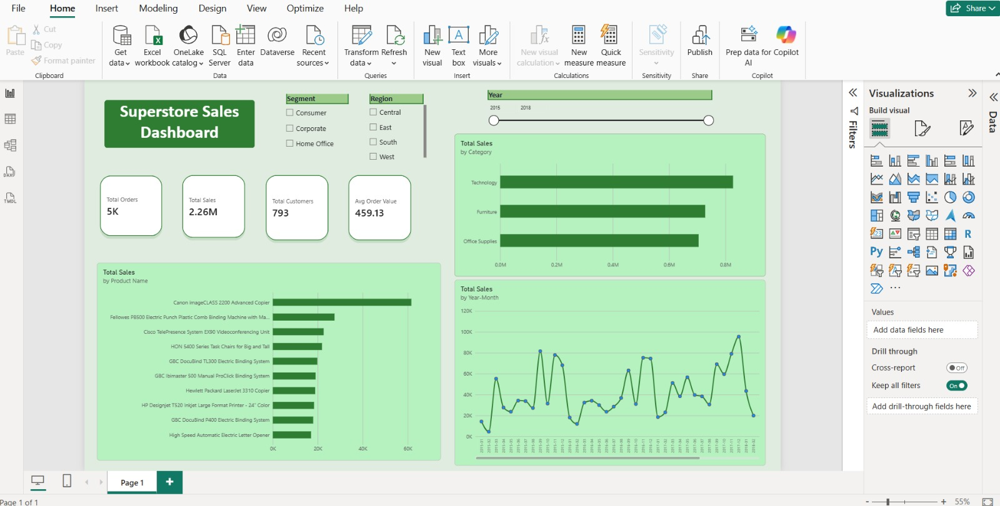

# Superstore Sales Dashboard | Power BI

## Overview
An interactive Power BI dashboard analyzing Superstore sales performance across
categories, products, regions, customer segments, and time periods.

## Tools & Skills
- Microsoft Power BI
- Power Query (data cleaning)
- DAX (measures)
- Data Modeling (date table, relationships)

## Dataset
Superstore Sales Dataset (Kaggle, by Rohit Sahoo), 2015-2018 sales data.

## Data Preparation
- Converted Order Date / Ship Date to proper date type (dd/mm/yyyy locale)
- Set Postal Code as text
- Built a Date table and related it to the sales table (Many-to-One)

## DAX Measures
- Total Sales = SUM(train[Sales])
- Total Orders = DISTINCTCOUNT(train[Order ID])
- Total Customers = DISTINCTCOUNT(train[Customer ID])
- Avg Order Value = DIVIDE([Total Sales], [Total Orders])
- Sales LY, YoY Growth %

## Dashboard Features
- KPI cards: Total Sales, Orders, Customers, Avg Order Value
- Monthly sales trend
- Sales by category
- Top 10 products by sales
- Slicers: Year, Region, Segment

## Key Insights
- Total sales of about 2.26M across 2015-2018
- Technology is the top-selling category
- Sales tend to peak in the last months of each year

## How to Open
Download the `.pbix` file and open it with Power BI Desktop.
